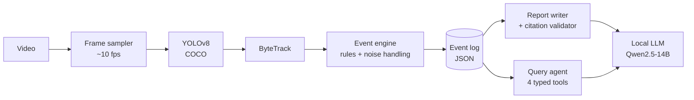

# SentryScribe

**CCTV footage in, searchable incidents out.** SentryScribe combines computer vision with a large language model.
Pretrained YOLOv8 and ByteTrack follow every person, vehicle and bag in a video. A rule engine turns their tracks into timestamped
security events. An open LLM running on the same GPU (Qwen2.5-14B-Instruct from Hugging Face on an A100) writes an incident report and answers questions about the footage, citing only those events.

[](https://colab.research.google.com/github/jaswantkolupuri-cpu/SentryScribe/blob/main/notebooks/colab_demo.ipynb)

## What it does

| | |
|---|---|
| **Detects and tracks** | People, cars, trucks, buses, motorcycles, bicycles, backpacks, handbags and suitcases, each with a stable ID (YOLOv8 + ByteTrack, COCO weights, no training). |
| **Raises six event types** | Zone intrusion, loitering, line crossing (with wrong-way flag), abandoned bag, crowding, vehicle in a pedestrian zone. |
| **Survives tracker noise** | Hysteresis, ID stitching, position smoothing, a line dead-band, a bag-attendance gate and backdated event starts. |
| **Writes the incident report** | Every sentence cites an event ID; a validator rejects unknown IDs and out-of-range times and retries once. |
| **Answers questions** | "Did anyone enter the restricted zone?" is answered through four typed search tools, never raw SQL. |
| **Produces evidence** | Annotated video, a snapshot per event, and JSON logs of events, tracks and run statistics. |

## Architecture



The vision half runs once per video. The language half runs on demand and can only read the event log, so the LLM never sees video.

## Results

Evaluated in a simulation study: 100 held-out scenes of 120 s each, with exact ground truth from an independent labeller and four levels of
tracker-like noise (box jitter, missed detections, ID switches, phantom tracks). Settings were tuned on a separate 40-scene development set and
frozen before the test run. An event counts as found when its type and zone match and it starts within ±3 s.

| Tracker noise | Naive per-frame rules (F1) | SentryScribe (F1, 95% CI) | Mean start error |
|---|---|---|---|
| Clean  | 1.000 | 1.000 (1.000–1.000) | 0.18 s |
| Low    | 0.411 | 0.999 (0.997–1.000) | 0.20 s |
| Medium | 0.325 | 0.997 (0.993–0.999) | 0.24 s |
| High   | 0.259 | **0.967** (0.952–0.980) | 0.33 s |

Removing one mechanism at a time (medium noise): without hysteresis F1 falls to 0.390, without ID stitching to 0.833, without the line
dead-band to 0.922. Full tables are in [`results/simulation_summary.md`](results/simulation_summary.md).
The detector is used as published (COCO mAP<sub>50-95</sub>: 37.3 for YOLOv8n, 53.9 for YOLOv8x). The end-to-end pipeline runs at about
7.8 frames/s with YOLOv8n on a laptop CPU.

**On real footage**, benchmark mode runs the full pipeline on nine hand-annotated MOT15 and MOT16 sequences (248 s; see *Running it*).
On a Colab A100 with YOLOv8x at 1280 px every clip ran 1.6–3.6× faster than real time, and all nine incident reports passed the citation check.
Event snapshots from that run are in [`results/real_footage/`](results/real_footage/).

Open [`showcase/index.html`](showcase/index.html) in a browser for an interactive replay of a test scene, with SentryScribe and the naive
rules side by side.

## Running it

### On Google Colab (recommended)

1. Open [`notebooks/colab_demo.ipynb`](notebooks/colab_demo.ipynb) in Colab (badge above).
2. *Runtime → Change runtime type → A100 GPU*. A T4 also works: the notebook then picks a smaller detector (YOLOv8m at 960 px) and a smaller LLM.
3. Run the cells top to bottom. In benchmark mode (the default) nothing needs uploading; check the zones on the preview, then process and evaluate.
4. Reports and questions use an open model downloaded from Hugging Face. The notebook picks the largest Qwen2.5 model that fits the GPU: 14B on a 40 GB A100 (about 30 GB download), 32B on an 80 GB one, 3B on a T4. No API key or account is needed.
5. The last cell downloads all outputs as a zip.

Zones and lines are set in the configuration cell as polygons in 0–1 coordinates, so one scene works at any resolution.

By default the notebook runs in **benchmark mode**: it downloads the nine static-camera training sequences of the public
[MOT15](https://motchallenge.net/data/MOT15/) and [MOT16](https://motchallenge.net/data/MOT16/) tracking benchmarks (about 3.2 GB), in which every person is boxed by hand.
It places zones from where people walk and derives event ground truth from those hand-annotated tracks, so step 8 scores the full
detector + tracker + engine on real footage with no labelling on your part. Only people are annotated, so it covers intrusion, loitering,
line crossing and crowding. Set `USE_BENCHMARK = False` in step 2 to use your own clips instead.

### Simulation study and tests (local)

```bash
pip install -r requirements.txt
python scripts/simulate.py                 # dev + held-out test, baseline, ablations, replay -> results/
python scripts/build_showcase.py           # rebuild showcase/index.html from results/
python tests/test_notebook.py notebooks/colab_demo.ipynb work/          # 22 logic checks
python tests/test_notebook.py notebooks/colab_demo.ipynb work/ --e2e    # + real YOLOv8n run (5 more checks)
```

## Repository layout

```
notebooks/colab_demo.ipynb   the full system: detection, tracking, events, evaluation, reports, Q&A
scripts/simulate.py          simulation study (runs the notebook's own engine code)
scripts/build_showcase.py    builds the interactive results page
tests/test_notebook.py       rule engine, evaluation, validator and tool-loop checks, optional end-to-end run
results/                     real-footage benchmark (results/real_footage/), simulation metrics, replay data and charts
showcase/                    interactive results page (open index.html)
docs/                        design document, viva notes and presentation
```

## Tech stack

Python · Ultralytics YOLOv8 · ByteTrack · OpenCV · Shapely · NumPy · pandas · matplotlib · Hugging Face Transformers (`Qwen/Qwen2.5-14B-Instruct`) · Google Colab

## Privacy

The system works with anonymous track IDs only and does no face recognition. The LLM runs locally and only ever sees the text event log; nothing is sent to an external service.
